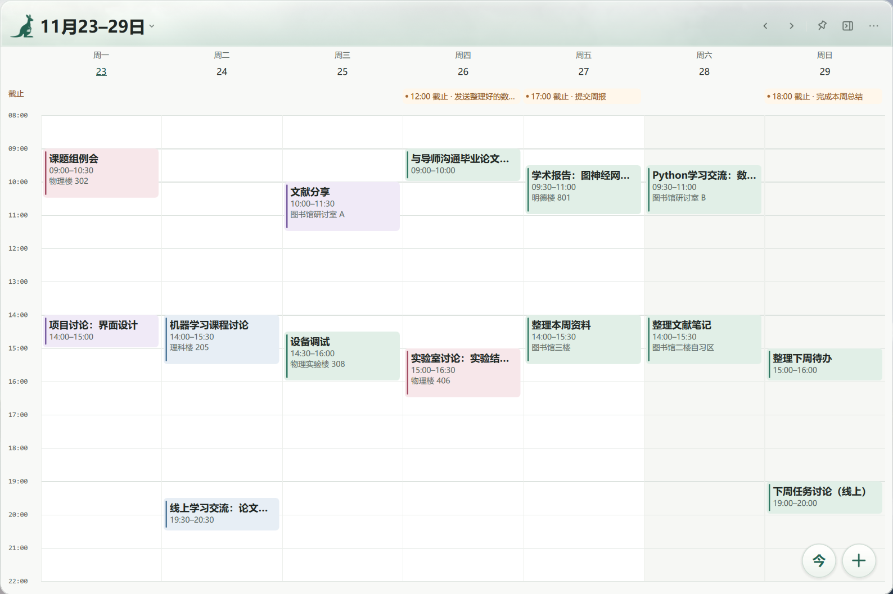
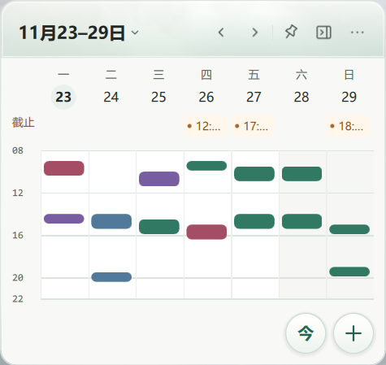
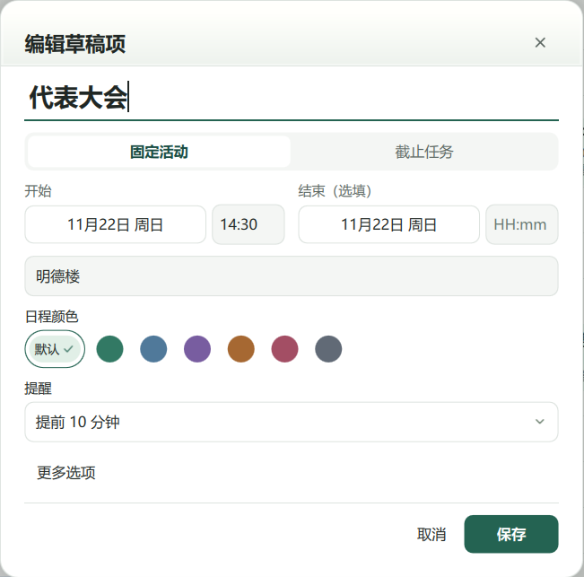

<div align="center">
  
  <h1>RooPlan 袋办</h1>
  <p><strong>把通知收进日历，让安排留在眼前。</strong></p>
  <p>为我自己的日常学习和安排开发的 Windows 桌面日程应用。</p>
  <p>从通知中整理活动与截止任务，在桌面边缘随时查看今日安排。</p>
  <p>
    
    
    
    
  </p>
</div>

<p align="center">
  
</p>

## 从通知到日程

群消息里的会议时间、地点和材料截止日期，往往分散在一段文字或一张截图里。RooPlan 可以接收通知，调用配置的 AI 服务生成草稿，再由你逐项核对、修改和确认，最后写入本地日历。

**通知文字 / 截图 → AI 解析 → 核对草稿 → 确认写入 → 日历提醒**

## 界面预览

<table>
  <tr>
    <td align="center"><strong>窄窗周概览</strong></td>
    <td align="center"><strong>今日浮窗</strong></td>
    <td align="center"><strong>编辑草稿项</strong></td>
  </tr>
  <tr>
    <td></td>
    <td></td>
    <td></td>
  </tr>
</table>

## 功能

| 功能 | 使用方式 |
| --- | --- |
| 周历与单日议程 | 查看七天安排，窄窗口中选择日期查看当天日程，通过小月历跳转日期。 |
| 桌面边缘浮窗 | 收起到屏幕边缘，悬停查看今日安排，滚动切换突出显示的日程。 |
| 通知导入 | 输入文字、附加截图或组合两者，生成可核对的日程草稿。 |
| 草稿核对 | 编辑、勾选和补充条目，确认后写入日历，支持保存草稿和重新解析。 |
| 冲突与关联 | 检查时间重叠，提示关联任务，修改前展示需要核对的内容。 |
| 日程管理 | 手动创建、编辑和删除日程，设置颜色、重复规则、提醒和截止时间。 |
| 搜索与撤销 | 按条件查找日程，对支持的操作进行撤销。 |

## 安装

面向 Windows x64。安装包包含运行所需的 Python 和 Qt 环境。

1. 在仓库的 **Releases** 页面下载 `RooPlan-*-Windows-x64-Setup.exe`。
2. 运行安装程序，完成安装后从开始菜单打开 RooPlan。
3. 使用通知解析时，在应用设置中配置 AI 服务地址、模型和 API Key。

当前安装包为预览版，尚未进行代码签名。安装包和 GitHub Release 的构建方法见 [Windows 打包说明](packaging/README.md)。

## 从源码运行

已使用 Windows x64 和 Python 3.13 验证。

```powershell
git clone https://github.com/Ghaon/RooPlan.git
cd RooPlan
py -3.13 -m venv .venv
.\.venv\Scripts\python.exe -m pip install PySide6-Essentials==6.9.2
.\.venv\Scripts\python.exe main.py
```

打开应用后，可通过窗口菜单进入 AI 设置。文本解析需要可用的 AI 服务，截图解析还需要所选模型支持图片输入。手动创建和查看日程可以直接使用。

## 数据与隐私

日程和草稿默认保存在当前用户的 `%LOCALAPPDATA%\RooPlan` 目录。AI 服务配置保存在同一目录，API Key 使用 Windows 当前用户的数据保护机制加密保存。解析通知时，提交的文字和截图会发送给你配置的 AI 服务，确认草稿后才会写入日历。

卸载应用时会保留本地数据。更换电脑或 Windows 用户账户时，需要重新配置 AI Key。

## 项目结构

```text
RooPlan/
├── main.py           应用入口、托盘与窗口启动
├── rooplan/          日历、草稿、AI 调用和本地数据逻辑
├── qml/              周历、浮窗、表单和交互界面
├── assets/           品牌图标与界面资源
├── tests/            自动化测试
└── packaging/        Windows 安装包构建脚本
```

运行自动化测试：

```powershell
.\.venv\Scripts\python.exe -m unittest discover -s tests -v
```

## 项目状态

RooPlan 是我根据自己的日常使用需求开发的个人项目，目前处于预览阶段。我会在实际使用中发现问题，并逐步完善日历、通知草稿和桌面浮窗等功能。欢迎通过 GitHub Issues 分享问题和使用建议。
